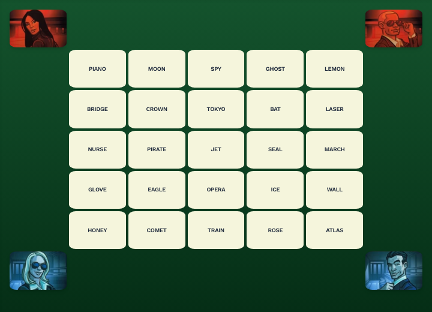
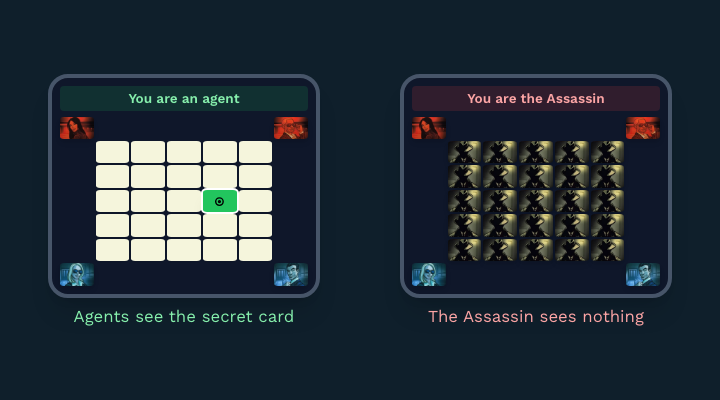

# Assassin - A Social Deduction Browser Game

Assassin is a fast-paced, browser-based social deduction game inspired by the popular card game **Codenames**, published by **Czech Games Edition**. Players must identify the hidden Assassin among them through strategic wordplay and deception. Built using **PubNub**, **HTML**, **Tailwind CSS**, and **JavaScript**, this game allows players to join virtual rooms and test their deduction skills.

## 🚀 Features
- **Real-time multiplayer** using PubNub
- **Simple, intuitive UI** powered by Tailwind CSS
- **Randomized roles** to keep every game fresh
- **Engaging word-based gameplay**
- **Quick and easy setup**—just share a room name and start playing!
- **Host controls**: only the room's creator starts rounds, and late joiners wait for the next round

## 🎮 How to Play

Assassin plays like **The Chameleon**, using a Codenames board as the word grid. Everyone except the Assassin knows the secret word. Players give one-word clues, then vote on who they think is bluffing.

### 1. Set up the table
Lay out 25 Codenames word cards in a 5×5 grid. Put red agent cards in the top corners and blue ones in the bottom corners, so everyone can line their phone up with the table. One player creates a room and shares its name, and everyone else joins it. You need 3 to 8 players.



### 2. One of you is the Assassin
When the host (the player who created the room) starts a round, everyone checks their phone. Agents find the highlighted card on the table: that's the secret word. The Assassin doesn't know it and has to bluff.



### 3. Give a clue, then vote
Going clockwise, everyone says **one word** linked to the secret word. Don't say the word itself or repeat a clue. Last round's Assassin goes first. In the first round, it's whoever most recently watched a spy movie.

Then debate. On the count of three, everyone points at their suspect. If there's a tie, the tied players each give **one more clue**, then everyone votes again between them. If it's still tied, the first player decides.

### 4. Reveal and score
The accused player shows their phone.

| Outcome | Points |
|---|---|
| Wrong player accused | Assassin +2 |
| Assassin caught, but guesses the secret word | Assassin +1 |
| Assassin caught and guesses wrong | Every agent +1 |

The first player to **5 points** wins. For the next round, **flip all 25 cards** to use the words on the back. After both sides have been played, deal 25 new cards.

### Good to know
- Refreshing the page puts you straight back into your room and round.
- Players who join mid-round wait and are dealt in next round.
- If the host leaves, another player becomes host. The host can also remove players who closed their tab.

## 🛠️ Tech Stack
- **PubNub** – Real-time communication
- **HTML, CSS (Tailwind)** – Frontend UI
- **JavaScript** – Game logic

## 📦 Installation
1. Clone the repository:
   ```sh
   git clone https://github.com/yourusername/codenames-assassin.git
   ```
2. Navigate to the project folder:
   ```sh
   cd codenames-assassin
   ```
3. Sign up for a **PubNub** account at [PubNub](https://www.pubnub.com/) to obtain your **publish** and **subscribe** keys.
4. Copy `keys.example.js` to `keys.js`:
   ```sh
   cp keys.example.js keys.js
   ```
5. Open `keys.js` and replace `your-publish-key` and `your-subscribe-key` with your actual PubNub keys.
6. Open `index.html` in a browser to play locally.

## 🌐 Deploying to GitHub Pages
Pushing to `main` deploys the site with the workflow in `.github/workflows/pages.yml`. It builds `keys.js` from two repository secrets, so the keys never go into git:
```sh
gh secret set PUBNUB_PUBLISH_KEY
gh secret set PUBNUB_SUBSCRIBE_KEY
```
Then set **Settings → Pages → Source** to **GitHub Actions**. Keys used in a browser game are always readable in the page source, so use a PubNub keyset dedicated to this game.

## 📌 Future Enhancements
- So many things

## 🏆 Acknowledgments
This game is inspired by the mechanics of **Codenames**, a game published by **Czech Games Edition**. We acknowledge and appreciate their creative work in the tabletop gaming industry.
