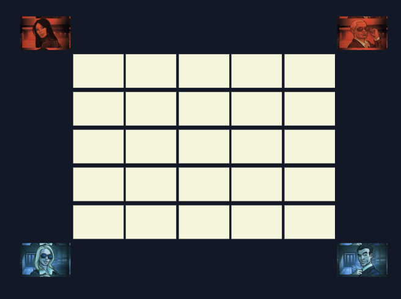
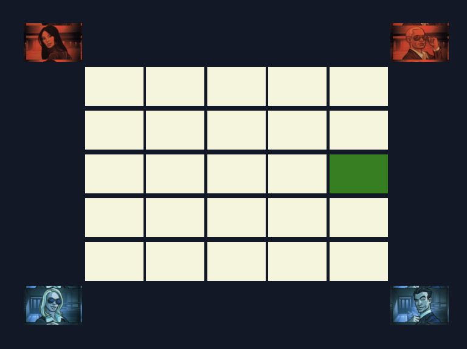

# Assassin - A Social Deduction Browser Game

Assassin is a fast-paced, browser-based social deduction game inspired by the popular card game **Codenames**, published by **Czech Games Edition**. Players must identify the hidden Assassin among them through strategic wordplay and deception. Built using **PubNub**, **HTML**, **Tailwind CSS**, and **JavaScript**, this game allows players to join virtual rooms and test their deduction skills.

## 🚀 Features
- **Real-time multiplayer** using PubNub
- **Simple, intuitive UI** powered by Tailwind CSS
- **Randomized roles** to keep every game fresh
- **Engaging word-based gameplay**
- **Quick and easy setup**—just share a room name and start playing!

## 🎮 How to Play

1. **Set Up**: Arrange the board as shown:
   

2. **Join or Create a Room**: Players can join an existing room or create a new one. The round starts when at least **3 players** are present.

3. **Round Start**: One player is randomly chosen as the **Assassin**.

4. **Role Indicators**: Non-Assassin players see the **round’s secret word**:
   

5. **First Player**: The first player is either:
   - The Assassin from the previous round, OR
   - The player who most recently watched a spy movie.

6. **Word Hinting**: Players take turns saying **one-word hints** about the secret word. The Assassin must blend in while avoiding detection.
   - **Words cannot be:**
     - The secret word itself
     - A word already said
     - More than one word

7. **Debate & Vote**: After all players have spoken, debate who the Assassin might be. Then, each player **votes** by pointing to their suspect.

8. **Reveal**:
   - The player with the most votes must **reveal their phone screen**.
   - If the Assassin was caught, they have **one last chance** to guess the secret word and escape.

9. **Tiebreaker**: If there’s a tie, the first player makes the final decision.

## 🛠️ Tech Stack
- **PubNub** – Real-time communication
- **HTML, CSS (Tailwind)** – Frontend UI
- **JavaScript** – Game logic

## 📦 Installation
1. Clone the repository:
   ```sh
   git clone https://github.com/yourusername/codenames-assassin.git
   ```
2. Navigate to the project folder:
   ```sh
   cd codenames-assassin
   ```
3. Sign up for a **PubNub** account at [PubNub](https://www.pubnub.com/) to obtain your **publish** and **subscribe** keys.
4. Copy `key.example.js` to `key.js`:
   ```sh
   cp key.example.js key.js
   ```
5. Open `key.js` and replace `your-publish-key` and `your-subscribe-key` with your actual PubNub keys.
6. Open `index.html` in a browser to play locally.

## 📌 Future Enhancements
- So many things

## 🏆 Acknowledgments
This game is inspired by the mechanics of **Codenames**, a game published by **Czech Games Edition**. We acknowledge and appreciate their creative work in the tabletop gaming industry.
